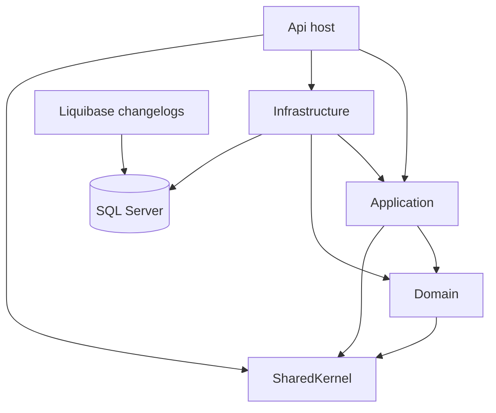

# LifeFit AI backend

Part 1 is the production foundation for the LifeFit AI API. It hosts the process, logging, validation pipeline, and the SQL Server connection used for runtime data access. Liquibase schema lives in `/database`, outside this .NET solution. It does not implement authentication or product features.

## Architecture



Liquibase, in `/database`, creates the schema. EF Core will map tables after a later changeset adds them. The `DbContext` in this part has no business sets and does not migrate the database.

## Folder structure

```text
backend/
├── LifeFitAI.sln
├── src/
│   ├── Api/
│   ├── Application/
│   ├── Domain/
│   ├── Infrastructure/
│   ├── SharedKernel/
│   └── Modules/
├── docker/
│   └── Dockerfile
└── tests/
```

Module folders are reserved for future vertical slices: Users, Tenant, Gym, Membership, Trainer, Attendance, Nutrition, Workout, AI, and Notifications.

## Tech stack

| Area | Choice |
| --- | --- |
| Runtime | .NET 9 |
| HTTP | Minimal APIs, URL versioning, Swagger, ProblemDetails |
| Application | MediatR 12, FluentValidation |
| Data | SQL Server 2022, EF Core 9, Liquibase |
| Logs | Serilog console and rolling compact JSON files |
| Delivery | Docker Compose, GitHub Actions |

## Run the API

Set the SQL Server connection string. Do not commit the password.

```powershell
$env:ConnectionStrings__SqlServer = "Server=localhost,1433;Database=LifeFitAI;User Id=sa;Password=<local-password>;TrustServerCertificate=True;Encrypt=False"
dotnet run --project src/Api/LifeFitAI.Api.csproj --launch-profile http
```

| Endpoint | Purpose |
| --- | --- |
| `GET /api/v1/platform` | Foundation status |
| `GET /health/live` | Process liveness |
| `GET /health/ready` | SQL Server readiness |
| `GET /swagger` | OpenAPI UI in Development |

Logs are written to `src/Api/logs/` as rolling JSON files. That folder is created on startup and is not committed.

## SQL Server and Liquibase

Schema changes belong in `/database`. From the repository root, copy `.env.example` to `.env` and set `MSSQL_SA_PASSWORD` to a strong local password.

```powershell
docker compose up --build
```

Startup order:

1. SQL Server 2022 becomes healthy on port 1433.
2. `database-init` creates the `LifeFitAI` database if it is missing.
3. The Liquibase image validates and applies `database/changelog/db.changelog-master.yaml`, then exits.
4. The API starts on port 8080 and connects for data access. It does not run migrations.

The Part 1 changelog creates the `app` schema and no business tables. Later tables are new numbered changesets with a ticket id, author, rollback, index review, and performance note. The naming and index rules are in `docs/Database-Standards.md`.

Stop the stack from the repository root:

```powershell
docker compose down
```

Add `-v` to delete the SQL Server volume.

## Development workflow

1. Build and test before committing.

```powershell
dotnet build LifeFitAI.sln --configuration Release
dotnet test LifeFitAI.sln --configuration Release --no-build
```

2. Add a schema change as a Liquibase changeset under `/database`. Do not add an EF Core migration.
3. When a feature starts, add its command, handler, validator, and minimal endpoint in the owning module.
4. Use a Conventional Commit when the change is committed.

GitHub Actions restores, builds, and tests the solution. It does not deploy.
