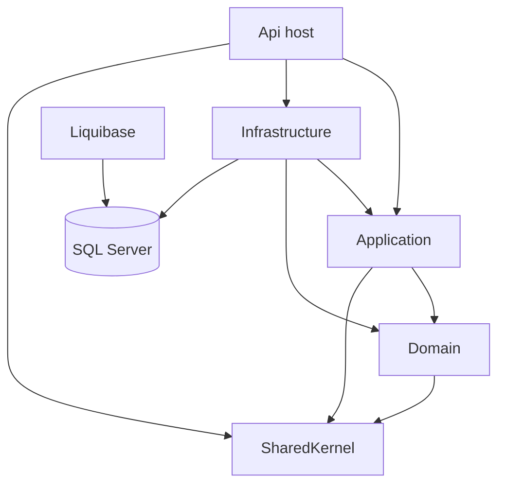

# Architecture

LifeFit AI Part 1 separates the .NET host from the database project and leaves business slices empty. The charter is [Architecture-Charter.md](Architecture-Charter.md). Database rules are [Database-Standards.md](Database-Standards.md).



Liquibase, in `/database`, owns the schema. EF Core is registered with an empty `DbContext` so later modules can map tables that a changeset has already created. The API uses EF Core for runtime data access and does not run migrations. Liquibase does not reference a .NET project.

```text
Backend (ASP.NET Core, EF Core, MediatR)
        |  runtime data access
        v
    SQL Server
        ^
        |  schema management
Liquibase (/database)
```

A use case is a MediatR request, a FluentValidation validator, and a controller action that only dispatches the request.

## Explicitly deferred

- Authentication and refresh tokens
- Business tables and product workflows
- Tenant row filters
- Redis and object storage
